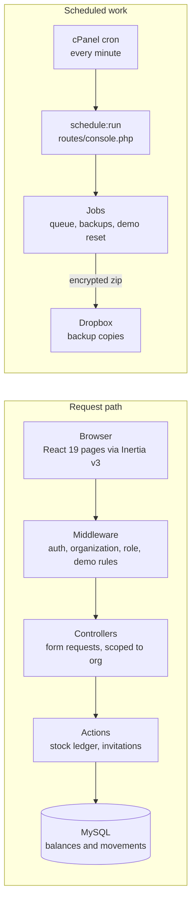

# Biponon Developer Guide

As of 16 November 2026

Biponon is a multi-tenant inventory and order management app: one Laravel 13 monolith in `backend/` that serves a React 19 single-page UI through Inertia v3, backed by MySQL in production. This guide covers how it is built, how to run, test and deploy it, and how to upgrade its frameworks.

## Overview and architecture

- **One app, no separate API.** Controllers return `Inertia::render('page/name', props)`; React pages in `resources/js/pages` receive the props. Forms post back to the same Laravel routes. The `frontend/` folder from the original blueprint is unused.
- **Tenancy by organization.** Every business row carries `organization_id`. The `organization` middleware (`SetCurrentOrganization`) resolves the current organization from the session and puts it on `$request->attributes`. Controllers use the `ScopesToOrganization` trait and always query through `$organization->relation()`, returning 404 for another tenant's records.
- **Stock ledger.** `stock_movements` is the append-only history; `stock_balances` (organization, variant, warehouse, quantity) is the current state. Both are written only by `App\Actions\Inventory\RecordStockMovement`, inside a transaction with row locks.
- **Platform layer.** Super-admins (`users.is_super_admin`) create and suspend organizations under `/admin` and never enter tenant data. A `platform_settings` table holds site-wide switches such as demo mode.
- **No long-running processes in production.** The host is shared cPanel hosting, so the queue and scheduled jobs run from a once-a-minute cron (`schedule:run`), and server-side rendering is off.

Requests flow left to right and are checked for organization and role before any controller runs. Scheduled work starts from cron, not a long-running worker.

## Tech stack

Versions are what was installed on the as-of date; `composer.json` and `package.json` hold the allowed ranges.

| Layer | Package | Installed | Role |
| --- | --- | --- | --- |
| Runtime | PHP | 8.3 locally, 8.4 in CI and on the server | `composer.json` requires `^8.3` |
| Runtime | Node.js | 22 | Build only; not needed on the server |
| Backend | laravel/framework | 13.40.0 | Application framework |
| Backend | laravel/fortify | 1.41.0 | Login, password reset, email verification, 2FA, passkeys |
| Backend | inertiajs/inertia-laravel | 3.7.0 | Server side of Inertia |
| Backend | laravel/wayfinder | 0.1.23 | Generates typed TypeScript route and controller functions |
| Backend | spatie/laravel-backup | 10.3.3 | Nightly database backups |
| Frontend | react, react-dom | 19.3.1 | UI, with the React Compiler (babel-plugin-react-compiler) |
| Frontend | @inertiajs/react, @inertiajs/vite | 3.11.0 | Client side of Inertia |
| Frontend | tailwindcss | 4.3.5 | Styling (CSS-first config in `resources/css/app.css`) |
| Frontend | Radix UI, lucide-react, sonner | various | shadcn-style components in `components/ui`, icons, toasts |
| Frontend | recharts | 3.10.1 | Dashboard chart |
| Frontend | typescript | 5.9.3 | Type checking (`npm run types:check`) |
| Build | vite-plus (`vp`) | 1.4.0 | Vite-compatible build, dev server, format and lint; `vite` is aliased to it |
| Build | laravel-vite-plugin, @laravel/vite-plugin-wayfinder | 3.2.1, 0.1.11 | Laravel and Wayfinder integration |
| Quality | phpunit/phpunit | 12.5.43 | Tests |
| Quality | laravel/pint, larastan | 1.32.1, 3.14.0 | PHP formatting and static analysis |
| Dev tools | laravel/boost | 2.10.4 | MCP server and AI guidelines (dev only) |

## Local setup

You need PHP 8.3 or newer, Composer, Node.js 22 and MySQL 8 (SQLite works for a quick start; the tests always use it). Everything runs from `backend/`.

1. Install and configure: `composer run setup`. It installs PHP and npm packages, copies `.env.example` to `.env`, generates the app key, migrates and builds the assets.
2. Point `.env` at your database (`DB_CONNECTION`, `DB_DATABASE`, ...) and run `php artisan migrate`.
3. Create your own super-admin: `php artisan biponon:super-admin you@example.com --create` (asks for a name and password).
4. Load sample data: `php artisan biponon:demo`. This builds the "Demo Fashion Ltd" organization; its logins are in the Demo mode section.
5. Start everything: `composer run dev` (runs `php artisan dev`: web server, queue, logs and Vite together). Or run `php artisan serve` and `npm run dev` yourself.
6. After changing routes or controllers, regenerate the typed routes: `php artisan wayfinder:generate --with-form`. The Vite plugin also does this while `npm run dev` runs.

`php artisan db:seed` is optional. It creates a local super-admin and a "Biponon" organization with sample stock only when `SEED_ADMIN_EMAIL` and `SEED_ADMIN_PASSWORD` are set in your own `.env`; otherwise it skips them. Never put real login details in the repository.

## Code layout and conventions

| Path (under `backend/`) | Holds |
| --- | --- |
| `app/Http/Controllers/{Catalog,Inventory,Operations,Purchasing,Sales,Reports,Organization,Admin,Settings}` | One controller per page or resource, grouped like the sidebar |
| `app/Http/Requests/...` | Form requests: validation, `authorize()`, input clean-up in `prepareForValidation()` |
| `app/Actions/` | Reusable domain operations: `Inventory/RecordStockMovement`, `SummarizeStock`, `AverageReceiptCosts`, `Organizations/SendInvitation`, `AcceptInvitation`, `Demo/BuildDemoCompany` |
| `app/Concerns/` | Shared traits: `ScopesToOrganization`, `StreamsCsv`, `ParsesDateFilters`, `FormatsMoney`, and the serial-number validators |
| `app/Http/Middleware/` | `SetCurrentOrganization` (`organization`), `EnsureOrganizationRole` (`role:manager`), `RestrictDemoAccounts`, `HandleInertiaRequests` (shared props) |
| `app/Console/Commands/` | `biponon:super-admin`, `biponon:demo` |
| `routes/web.php`, `settings.php`, `console.php` | Routes; `console.php` also holds the schedule |
| `resources/js/pages/` | One React page per Inertia view, path = view name |
| `resources/js/components/`, `components/ui/` | Shared components; `ui/` is the shadcn-style kit |
| `resources/js/lib/` | `datetime.ts` (organization timezone), `money.ts`, `demo-notes.ts`, `landing-copy.ts` |
| `resources/js/actions/`, `routes/` | Generated by Wayfinder; never edit by hand |
| `tests/Feature/` | Feature tests, one file per page or flow |

**The page pattern.** Most pages follow one shape, so copy a sibling when adding one:

- The controller uses `ScopesToOrganization`, queries through `$organization->products()` (and so on), and calls `ensureBelongsToOrganization()` for route-bound models.
- A form request validates with organization-scoped `Rule::unique(...)->where('organization_id', ...)`.
- Success is reported with `Inertia::flash('toast', ['type' => 'success', 'message' => __('...')])` and `back()`.
- The index page is a table plus one add/edit dialog using `<Form {...Controller.store.form()}>` from Wayfinder, plus a delete confirmation dialog.
- Deleting something that has history is refused with "deactivate instead"; every list keeps an `is_active` flag.

**Conventions.** Follow the closest sibling file. PHP: explicit return types, constructor promotion, PHPDoc over inline comments, `vendor/bin/pint --dirty`. TypeScript: format only the files you touched with `npx vp fmt <file>` (the repo is not formatter-clean as a whole), and keep `npm run types:check` clean. New dependencies need the owner's approval.

## Domain model and key flows

**Catalog.** `products` have `product_variants`, one per size × colour, each with a SKU (upper-cased, unique per organization), barcode, price and optional `reorder_level`. A variant's size and colour can't change after creation. `sizes`, `colors`, `warehouses`, `suppliers` and `customers` are per-organization lists with `is_active`.

**Stock is quantity-based.** `stock_balances` is the source of truth for on-hand quantity (whole units, never negative). `stock_movements` records every change with `movement_type` (`receive`, `transfer`, `dispatch`, `return`), from/to warehouse, quantity, who and when (`occurred_at`), and optional links to a purchase or sales order line and a `unit_cost`. Always go through `RecordStockMovement::handle()` inside `DB::transaction()`. It locks the balance rows, throws `DomainException` if a balance would go below zero, and refuses to mix organizations.

**Serial numbers are optional.** `serial_numbers` (status `in_stock` or `dispatched`, current warehouse) attach to movements through the `serial_number_stock_movement` pivot. Quantities may drift from serial counts by design.

| Flow | Statuses | Rules worth knowing |
| --- | --- | --- |
| Purchase order (PO-0001 per organization) | draft → ordered → partially_received → received; closed; cancelled | Lines editable only in draft. Receiving can split a line across active warehouses and copies the line's `unit_cost` to the movement. Over-receiving is blocked. Costs are hidden from members, on the server. |
| Sales order (SO-0001 per organization) | draft → confirmed → partially_dispatched → dispatched; closed; cancelled | No reservations: confirming with too little stock is allowed (backorder warning). Dispatch can split across warehouses, capped by stock. Returns are linked to the order line and don't change its status. |
| Plain operations | receive, transfer, dispatch, return | For stock that isn't tied to an order. Same ledger, same rules. |

**Reports** (`app/Http/Controllers/Reports`): stock value uses the weighted average cost of costed receipts (managers and admins only). Sales count from `confirmed_at` in the organization's timezone. There are also purchases by supplier and slow-moving stock (no dispatch for 30, 60, 90 or 180 days). Every report streams a CSV through `StreamsCsv`, which escapes formula injection.

**Time and money.** Dates are stored in UTC and shown in the organization's timezone setting (default Asia/Dhaka, in `lib/datetime.ts`). Money is `decimal(18,2)`, shown in the organization's currency (default BDT, in `lib/money.ts`). Organization settings live in a JSON column with defaults in `Organization::SETTING_DEFAULTS`.

## Tenancy, roles and permissions

- **Membership.** Users join organizations through `organization_user` (role `admin`, `manager` or `member`; status `active` or `suspended`). Registration is off (`REGISTRATION_ENABLED=false`), so people join only through `organization_invitations`. These store a SHA-256 hash of the token, expire after 7 days, and allow one pending invitation per email.
- **Current organization.** It is kept in the session (`current_organization_id`) and switched with `PUT current-organization`. Users with no active organization go to `/no-organization`; super-admins go to the admin pages instead.
- **Roles.** Ranks are admin > manager > member, checked with `Organization::roleIncludes($role, 'manager')`. Routes use the `role:manager` or `role:admin` middleware (`EnsureOrganizationRole`); member management uses the `manage-members` gate.
- **Hiding actions in the UI.** `HandleInertiaRequests` shares `auth.can` flags (`runOperations`, `manageCatalog`, `managePurchasing`, `manageSales`, `viewCosts`, `manageMembers`, `manageSettings`, `administerPlatform`). Pages hide what the user would be refused. The server is still the authority: costs are removed from props and from CSV exports for members.
- **Super-admins.** The `is_super_admin` flag can only be set with `php artisan biponon:super-admin`. The `/admin` routes (`can:super-admin`) manage organizations and access requests and never show tenant data.
- **Demo accounts.** Users with `is_demo` are restricted by `RestrictDemoAccounts`: logged out when the site isn't in demo mode, and refused the routes in `BLOCKED_ROUTES` (profile, password, 2FA, passkeys, invitations, member changes, leaving the organization).

## Testing

The suite has 320 PHPUnit tests (318 pass, 2 skipped by design) and runs in about a minute on in-memory SQLite.

- Run everything: `php artisan test --compact`. One file or test: add the path or `--filter=test_name`.
- Create a test: `php artisan make:test --phpunit SomethingTest`. Tests are feature tests that hit routes and assert on Inertia props (`assertInertia`, `assertInertiaFlash`).
- Build data with factories. `User::factory()->withOrganization($organization)` makes a member, `->superAdmin()` a platform admin; child factories take their `organization_id` from the parent.
- Cover the behaviour you changed and its important failures (wrong role, another organization's record, invalid input). Pure styling changes need no test.
- Frontend checks: `npm run types:check`; `npx vp fmt <file>` on touched files; `npm run build` before committing UI changes.

**SQLite is not MySQL.** Tests won't catch MySQL-only failures. The known one: subtracting two unsigned columns fails in MySQL when the result is negative (error 1690), so cast with `CAST(... AS SIGNED)`. Case-sensitivity of comparisons also differs. Check new raw SQL on a local MySQL database before you ship it.

## Deployment and operations

Production is shared cPanel hosting with PHP 8.4 and MySQL, but no Composer, no Node and no long-running processes. So GitHub builds a ready-to-run copy, publishes it and deploys it over SSH; the server only pulls. The full first-time setup is in [DEPLOYMENT.md](DEPLOYMENT.md).

1. Push to `main`.
2. `.github/workflows/production-build.yml` runs on PHP 8.4 and Node 22. It installs dependencies, builds the assets and runs the tests. It then installs production-only Composer packages and commits the result to the `production` branch: the backend without tests, with `vendor/`, `public/build/` and `.cpanel.yml`. A red run publishes nothing.
3. The same run logs in to the server over SSH with a deploy key (repo secrets `SSH_PRIVATE_KEY`, `SSH_KNOWN_HOSTS`, `SSH_HOST`, `SSH_USER`) and runs `.github/deploy/auto-deploy.sh` there: fast-forward `~/biponon` to `origin/production`, then `php artisan migrate --force` and `php artisan optimize` with `/usr/local/bin/php`. The output is in the Actions log.
4. It then checks `https://saas-backend.mypersonalwork.com/up` and fails the run if the site doesn't answer.

The deploy step runs on every build and does nothing when the server is already current, so **Actions → Production build → Run workflow** retries a failed deploy. `touch ~/auto-deploy.off` on the server pauses deploys (`rm` it to resume). The manual route still works: cPanel **Git Version Control → Manage → Pull or Deploy → Update from Remote**, then **Deploy HEAD Commit**, which runs the same two commands from `.cpanel.yml`. Keep `auto-deploy.sh` and `.cpanel.yml` in step.

The app lives outside the web root. The subdomain's document root (`~/public_html/saas-backend/public`) is a symlink to `~/biponon/backend/public`, so `.env` can't be reached over HTTP. Edit only `backend/.env` on the server; a changed tracked file blocks the next pull.

**Scheduler.** One cron entry runs every minute: `cd /home/myperson/biponon/backend && /usr/local/bin/php artisan schedule:run`. `routes/console.php` schedules:

| When (Asia/Dhaka) | Command | Purpose |
| --- | --- | --- |
| Every minute | `queue:work --stop-when-empty --max-time=50` | Sends queued mail and runs the Dropbox upload job |
| 01:30 | `backup:clean` | Prunes old local backups |
| 02:00 | `backup:run --only-db` | Password-protected (AES-256) database zip in `storage/app/private/<BACKUP_NAME>` |
| 03:00, only in demo mode | `biponon:demo --fresh` | Rebuilds the demo organization |
| 08:00 | `backup:monitor` | Emails `BACKUP_NOTIFICATION_EMAIL` if the backup is missing or unhealthy |

After each successful backup, `QueueBackupUploadToDropbox` queues `UploadBackupToDropbox`. That job trades the refresh token for an access token and uploads the zip, retrying after 1 and 5 minutes. After uploading it keeps only the newest `DROPBOX_KEEP_BACKUPS` zips in the folder (by Dropbox upload time) and deletes the rest; other files there are left alone. A failed clean-up is logged but does not fail the job, so the zip is never uploaded twice.

**Production `.env` keys** beyond Laravel's usual ones (template: `backend/.env.production.example`):

| Key | Value or purpose |
| --- | --- |
| `INERTIA_SSR_ENABLED` | `false` (no Node process on the host) |
| `REGISTRATION_ENABLED` | `false` (invitation only) |
| `QUEUE_CONNECTION` | `database` |
| `DB_DUMP_PATH` | Folder holding `mysqldump` on the server |
| `BACKUP_NAME`, `BACKUP_NOTIFICATION_EMAIL`, `BACKUP_ARCHIVE_PASSWORD` | Backup folder, failure alerts, zip password |
| `DROPBOX_CLIENT_ID`, `DROPBOX_CLIENT_SECRET`, `DROPBOX_REFRESH_TOKEN` | Dropbox app; empty = uploads skipped |
| `DROPBOX_BACKUP_FOLDER` | Dropbox folder, default `/saas_database` |
| `DROPBOX_KEEP_BACKUPS` | Zips kept in that folder, default 7; `0` keeps all |
| `MAIL_MAILER`, `RESEND_API_KEY`, `MAIL_FROM_ADDRESS` | `resend` + a Resend API key; the sender's domain must be verified in Resend. The server IP is on a spam blocklist, so cPanel SMTP is not used. Test with `php artisan biponon:test-mail you@example.com` |

## Demo mode, landing page and access requests

- **Landing page** (`pages/welcome.tsx`, at `/`). All copy is in English and Bangla in `lib/landing-copy.ts`. The language comes from the browser, or the visitor's choice stored in `localStorage` (`hooks/use-landing-language.ts`). The Hind Siliguri font downloads only when Bangla text appears.
- **Access requests.** The form posts to `access-requests` (`AccessRequestController@store`) and is protected by a honeypot field, 5 tries a minute per IP, and one request per email a day. Super-admins work through the requests at `/admin/access-requests`. "Create organization" opens the create dialog filled in from the request and closes the request once created.
- **Site mode.** A super-admin switches Production / Demo under **Settings → Appearance** (`PUT settings/site-mode`, stored in `platform_settings`, cached forever and cleared on change; `PlatformSetting::demoMode()`). It controls the landing and login pages only: in demo mode they show the yellow "how it is built" panel (`components/demo-panel.tsx`, text in `lib/demo-notes.ts`), and the login page offers the demo accounts.
- **Demo company.** `php artisan biponon:demo [--fresh]` (`App\Actions\Demo\BuildDemoCompany`) builds "Demo Fashion Ltd" (slug `demo-fashion`). Its history runs over 150 days with a fixed random seed, recorded through `RecordStockMovement`, so every rebuild gives the same data dated from today. Its online shop is open with every active product shown in it (no photos), so the Next.js shop keeps working after each nightly rebuild. `--fresh` deletes the organization child-first and keeps the demo users.
- **Demo accounts.** `admin@`, `manager@` and `staff@demo-fashion.test`, password `demo-password`. This is public on purpose: it is shown on the login page. Inside the app the panel shows only for these accounts (`<DemoPanel inApp />`), whatever the site mode. They can only log in while demo mode is on.

## Known gotchas and troubleshooting

| Symptom | Cause and fix |
| --- | --- |
| Every `.form()` call breaks after regenerating routes | Run `php artisan wayfinder:generate --with-form`; Vite is set up with form variants |
| "Unable to locate file in Vite manifest" | Run `npm run build`, or keep `npm run dev` running |
| A field arrives as `null` and fails an `array` rule | `ConvertEmptyStringsToNull` turns `''` into `null`; normalise in `prepareForValidation()` (`?? []`) |
| Pagination drops an empty date filter | Same middleware; pass `''` through `appends()` rather than `withQueryString()` |
| Type errors with dates | `now()` returns `CarbonImmutable` here; type-hint `CarbonInterface` |
| React hydration warning on form ids | Use `useId()`, never a module-level counter |
| MySQL error 1690 "BIGINT UNSIGNED value is out of range" | Unsigned subtraction went negative; `CAST(... AS SIGNED)` (see Testing) |
| cPanel says "could not contact the remote repository" | Usually a locally modified tracked file on the server. In `~/biponon` run `git status`, discard or stash it, then `git pull origin production` in the terminal for the real error |
| Paths mangled in Git Bash on Windows | Prefix commands with `MSYS_NO_PATHCONV=1` |
| Production `.env` sets `DROPBOX_FOLDER` but uploads ignore it | The config reads `DROPBOX_BACKUP_FOLDER`; rename the key in the server's .env (the template uses the right name since 2026-11-16) |

## Upgrading the frameworks

Upgrade one framework at a time, on a branch, and ship each upgrade as its own release, so a problem points straight at its cause. Several packages come in server and client halves that must move together. The table lists them.

### The process

1. **Branch and back up.** Create a branch from `main`. Make sure last night's backup exists in Dropbox before a release that runs migrations.
2. **See what's behind.** `composer outdated --direct` and `npm outdated` in `backend/`.
3. **Read before you change.** Read the official upgrade guide or changelog of every version you skip, not just the latest one.
4. **Upgrade one group** (one row of the table below), then `composer install` / `npm install`.
5. **Regenerate and check:** `php artisan wayfinder:generate --with-form`, `php artisan test --compact`, `npm run types:check`, `npm run build`, `vendor/bin/pint --dirty`.
6. **Click through the app** on a local MySQL database with demo data (`php artisan biponon:demo --fresh`): log in with each demo role, then open the dashboard, receive and transfer stock, receive a PO, dispatch and return an SO, open all four reports and download one CSV.
7. **Release.** Merge to `main` and wait for a green Production build; it deploys itself and checks `/up`. Repeat the click-through on the live site.
8. **Roll back if needed.** First pause deploys (`touch ~/auto-deploy.off`), or the next build puts the new version back. In `~/biponon` run `git log` to find the previous `production` commit, then `git reset --hard <commit>` and `php artisan optimize`. Avoid destructive migrations in an upgrade release, so the old code still works with the new database.

### What moves together

| Upgrade | Change together | Where it touches this app |
| --- | --- | --- |
| PHP | `composer.json` `require.php`, the `php-version` in `production-build.yml`, the server's PHP (cPanel MultiPHP Manager and `/usr/local/bin/php` for cron), your local PHP | `vendor/` is built in CI, so CI must use the same PHP minor as the server. Raise the server first, then CI. |
| Laravel | `laravel/framework` plus first-party packages that pin it: fortify, tinker, pail, sail, pint, boost, larastan, phpunit, collision | Follow the upgrade guide. Compare `bootstrap/app.php`, `config/*` and `routes/` with a fresh `laravel/laravel` skeleton of the new version. Watch the middleware setup in `bootstrap/app.php` (custom aliases and the appended web middleware). |
| Fortify (and passkeys) | `laravel/fortify`, `@laravel/passkeys` | `config/fortify.php` features, `FortifyServiceProvider` views, `RestrictDemoAccounts::BLOCKED_ROUTES` (route names can change), the auth and settings pages. |
| Inertia | `inertiajs/inertia-laravel` with `@inertiajs/react` and `@inertiajs/vite` (same major) | `HandleInertiaRequests` shared props, `config/inertia.php` (SSR stays off in production), `Inertia::flash`, `useHttp`, `<Form>`, page `layout` props, `resources/js/app.tsx`. |
| React | `react`, `react-dom`, `@types/react`, `@types/react-dom`, `babel-plugin-react-compiler`, `@vitejs/plugin-react` | Components in `components/ui` (Radix); run the dev server and watch the browser console for warnings. |
| Tailwind CSS | `tailwindcss`, `@tailwindcss/vite`, `tailwind-merge`, `tw-animate-css` | All config is CSS-first in `resources/css/app.css` (`@theme`, the `--viz-*` chart colours, the Hind Siliguri font). Check light and dark themes. |
| Vite toolchain | `vite-plus` and the `vite` alias (`npm:@voidzero-dev/vite-plus-core@...`), both pinned to the same exact version, plus `laravel-vite-plugin` and `@laravel/vite-plugin-wayfinder` | `vite.config.ts`; scripts use `vp build`, `vp dev` and `vp check`. |
| Wayfinder | `laravel/wayfinder` with `@laravel/vite-plugin-wayfinder` | Pre-1.0: minor releases can break generated code. Regenerate with `--with-form` and run `types:check`; generated files in `resources/js/actions` and `routes` must not be edited by hand. |
| Backups | `spatie/laravel-backup` | Compare `config/backup.php` with the newly published config. The Dropbox upload listens for `BackupWasSuccessful`, so check that event still exists. Test with `php artisan backup:run --only-db` locally. |
| Charts and icons | `recharts`, `lucide-react` | Recharts majors affect `components/stock-flow-chart.tsx`; renamed icons fail `types:check`. |

Before a release, ask: did tests, types and the build pass? Did every demo role get through the click-through on MySQL? Was the live site checked after deploying?
